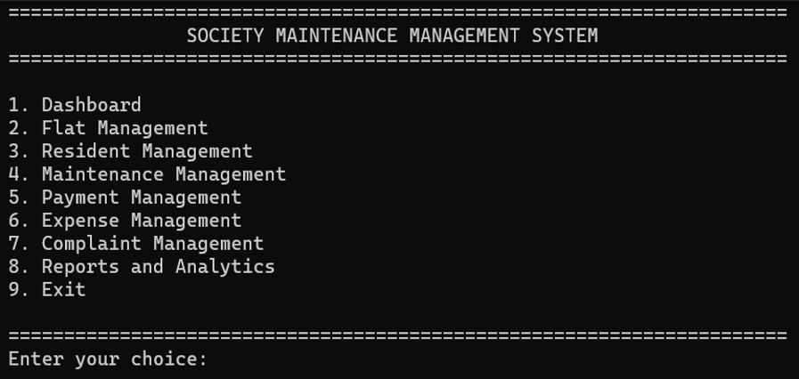
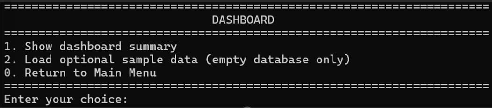
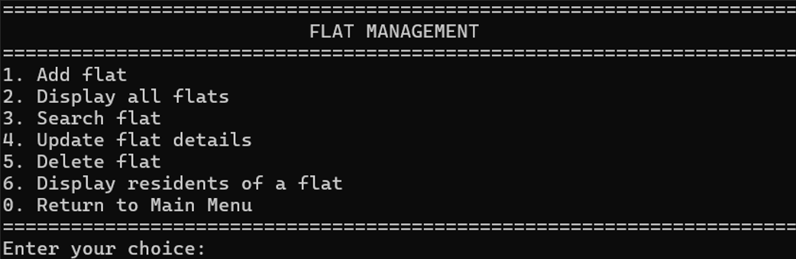
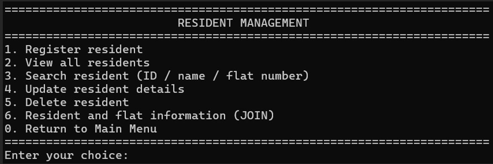
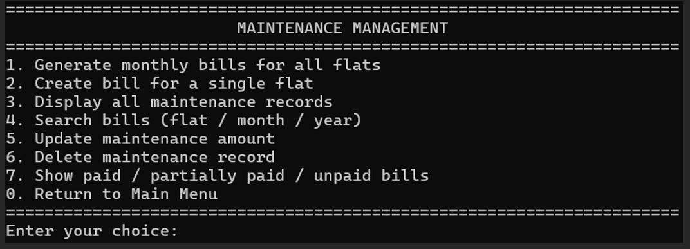
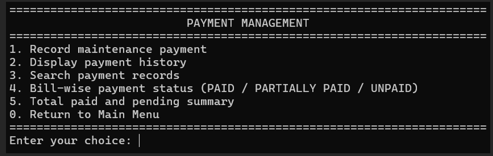
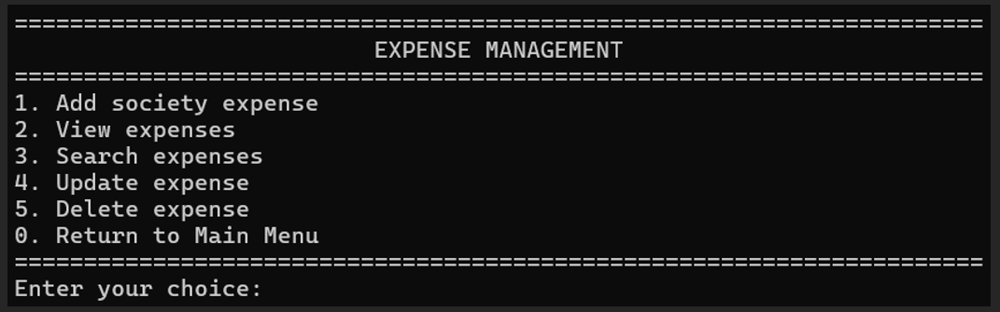
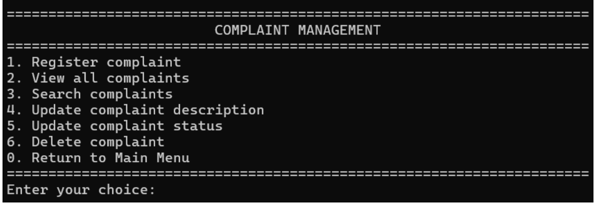
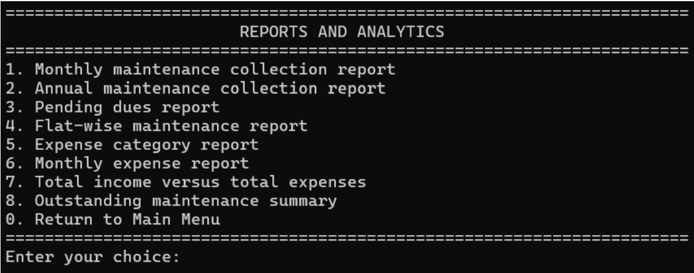

# Society Maintenance Management System

A console-based **Python 3 + SQLite3** project for managing a residential society. It provides facilities to manage flats, residents, monthly maintenance bills, payments (including partial payments), society expenses, complaints, and financial reports.

Developed as a Python and SQL practical assignment for **Anudip Foundation**.

## Features

- **Dashboard** – Flats, residents, bills, collections, pending dues, expenses, and complaint counts.
- **Flat Management** – Add, view, search, update, and delete flats.
- **Resident Management** – Register, view, search, update, and delete residents.
- **Maintenance Management** – Generate monthly bills, prevent duplicate bills, and track payment status.
- **Payment Management** – Accept partial payments, prevent overpayments, and maintain payment history.
- **Expense Management** – Record and manage categorized society expenses.
- **Complaint Management** – Track complaints through Pending, In Progress, and Resolved statuses.
- **Reports and Analytics** – Monthly and annual collections, pending dues, expenses, and financial summaries.
- **Sample Data** – Optional fictional Indian sample records.

## Technology Stack

| Technology | Details |
|---|---|
| Programming Language | Python 3 |
| Database | SQLite3 |
| Interface | Command Line / Console |
| Extra Packages | None |

## Installation

1. Install Python 3.8 or newer from [Python's official website](https://www.python.org/downloads/).
2. Clone this repository:

   ```bash
   git clone https://github.com/sumit3032006/Society-Maintenance-Management-System.git
   ```

3. Open the project folder:

   ```bash
   cd Society-Maintenance-Management-System
   ```

4. No additional package installation is required.

## How to Run

Execute the following command:

```bash
python society_management.py
```

On some systems, use:

```bash
python3 society_management.py
```

## Database Initialization

- The `society_management.db` database is created automatically when the application runs for the first time.
- Six tables are created: `flats`, `residents`, `maintenance`, `payments`, `expenses`, and `complaints`.
- Primary keys, foreign keys, UNIQUE, NOT NULL, and CHECK constraints are used.
- Foreign key enforcement is enabled for database connections.
- If the database is empty, the application asks whether to insert optional sample data.
- Sample data can also be loaded through the Dashboard.
- To reset the application, delete `society_management.db` and run the program again.

## Sample Usage

1. Run the application.
2. Enter `y` when asked whether to insert sample data.
3. Select **1 – Dashboard** to view the society summary.
4. Select **4 – Maintenance Management** to generate monthly bills.
5. Select **5 – Payment Management** to record full or partial payments.
6. Select **8 – Reports and Analytics** to view financial reports.

## Application Screenshots

The following screenshots demonstrate the main modules and functionality of the application.

## Application Screenshots

### 1. Main Menu


### 2. Dashboard


### 3. Flat Management


### 4. Resident Management


### 5. Maintenance Management


### 6. Payment Management


### 7. Expense Management


### 8. Complaint Management


### 9. Reports and Analytics


## SQL Concepts Demonstrated

- `CREATE TABLE`, `PRIMARY KEY`, `AUTOINCREMENT`
- `FOREIGN KEY`, `ON DELETE RESTRICT`
- `NOT NULL`, `UNIQUE`, `CHECK`, and `DEFAULT`
- `INSERT`, `SELECT`, `UPDATE`, and `DELETE` (CRUD operations)
- Parameterized SQL queries
- `INNER JOIN` and `LEFT JOIN`
- Aggregate functions: `SUM()`, `COUNT()`, and `AVG()`
- `GROUP BY`, `ORDER BY`, `WHERE`, and `LIKE`
- `CASE` expressions and `COALESCE`
- Subqueries and `strftime()`
- Database transactions using `COMMIT` and `ROLLBACK`

## Project Structure

```text
Society-Maintenance-Management-System/
│
├── society_management.py
├── README.md
├── requirements.txt
├── .gitignore
│
├── documentation/
│   └── Society_Maintenance_Synopsis.pdf
│
└── screenshots/
    ├── 01_main_menu.png
    ├── 02_dashboard.png
    ├── 03_flat_management.png
    ├── 04_resident_management.png
    ├── 05_maintenance_management.png
    ├── 06_payment_management.png
    ├── 07_expense_management.png
    ├── 08_complaint_management.png
    └── 09_reports.png
```

## Author and Course

- **Student Name:** Sumit Ravindra Jadhav
- **Course:** Python and SQL Practical Project
- **Training Institute:** Anudip Foundation
- **Project Title:** Society Maintenance Management System

## Important Note

All names, phone numbers, email addresses, and other personal details used in the sample data are fictional.

---

**Developed using Python 3 and SQLite3.**
